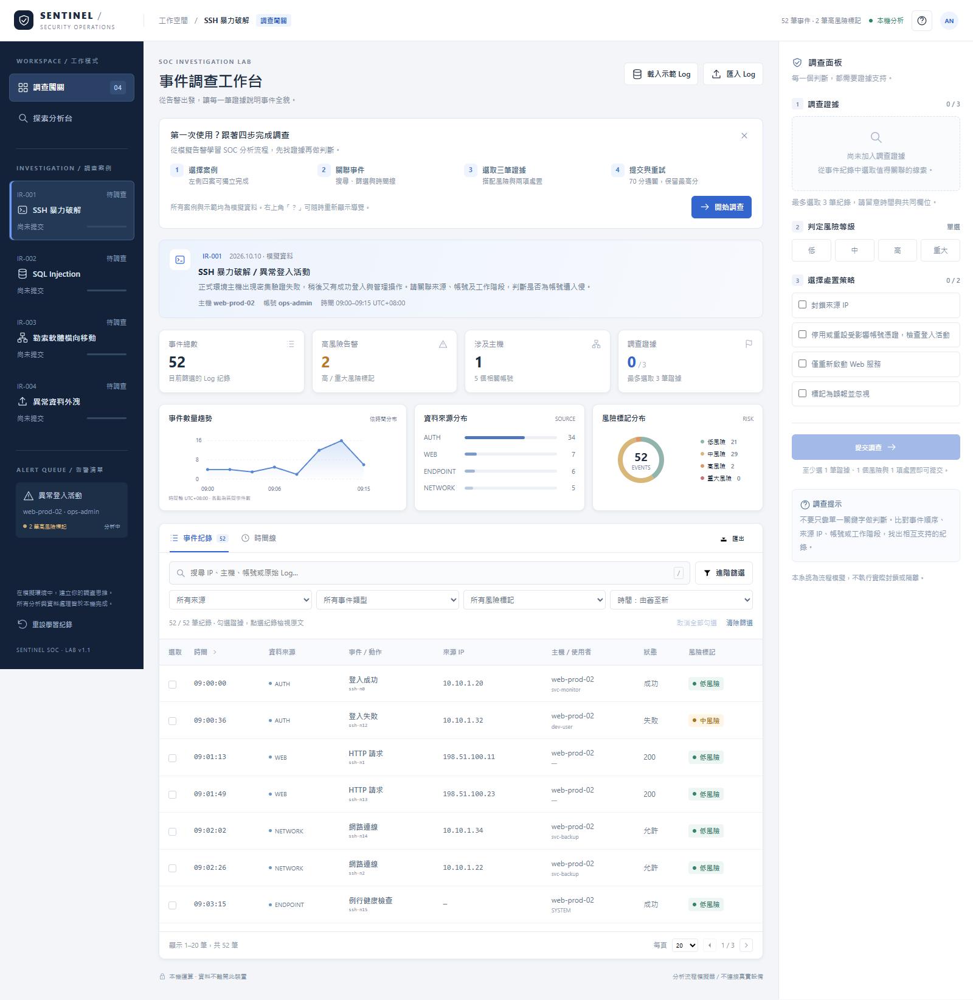
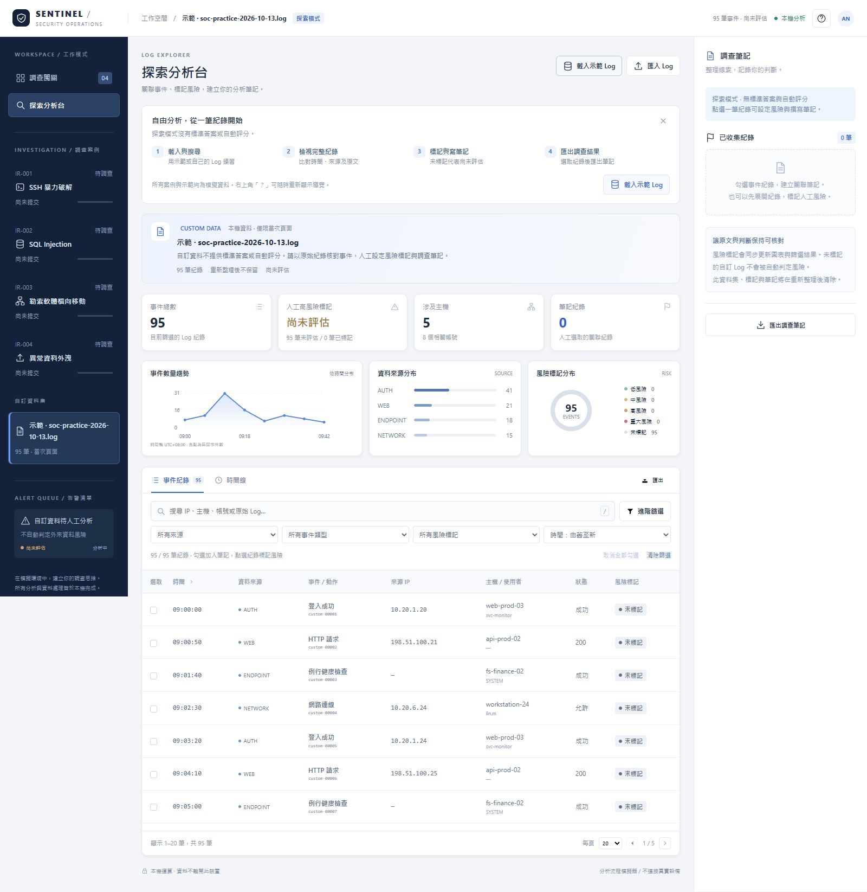
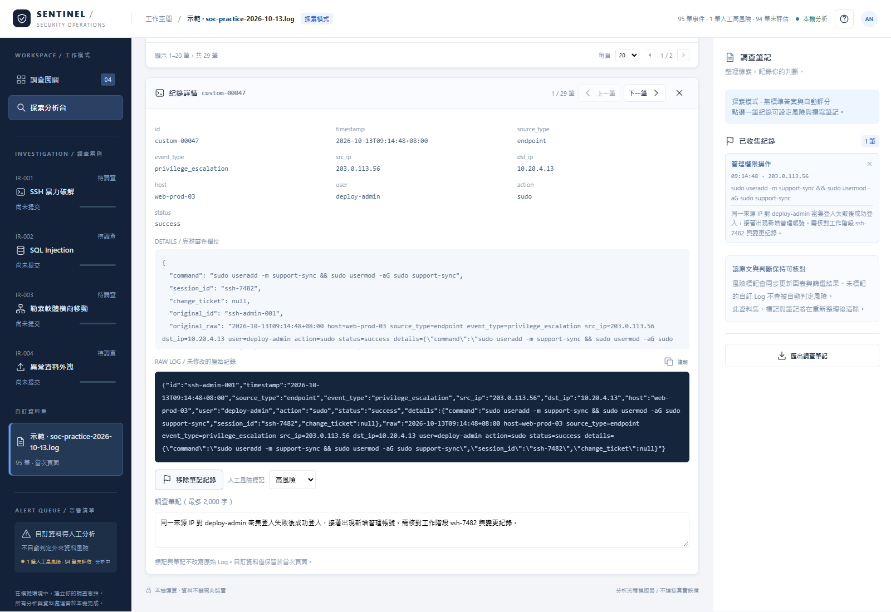
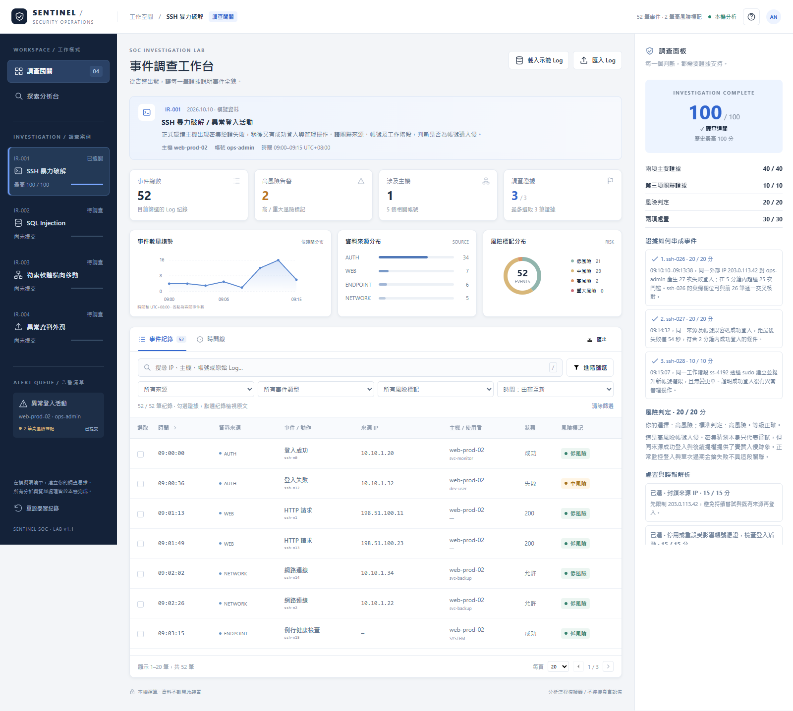
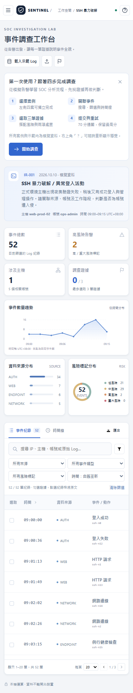

# SENTINEL SOC｜網路攻擊偵測與 Log 分析模擬系統

供課堂作業與作品展示使用的互動式 SOC 分析工作台。透過四個案例練習搜尋 Log、關聯事件、選取證據、判定風險與選擇處置，也能匯入自己的紀錄做人工分析。

- [線上展示（GitHub Pages）](https://chungweichang0918.github.io/sentinel-soc-simulator/)
- [GitHub 原始碼](https://github.com/chungweichang0918/sentinel-soc-simulator)
- 版本：1.1
- 主要交付檔案：`index.html`

> 網站右上角的「本機分析」代表資料在瀏覽器內處理，與網站是否上線不同。GitHub Pages 負責提供頁面，系統不連接真實監控設備、不執行封鎖或隔離；案例、示範 Log 與處置均為模擬情境。

## 快速開始

1. 開啟上方展示網址，或下載 `index.html` 後，以 Chrome / Edge 直接開啟。
2. 第一次使用時，畫面會顯示四步操作導覽。收起後可由右上角「？」→「重新顯示操作導覽」再次開啟。
3. 想體驗自訂分析，可直接按「載入示範 Log」。95 筆示範紀錄內嵌於 HTML，不需要另外下載或連網。

所有 HTML、CSS、JavaScript、圖示、SVG 圖表、案例及示範資料均包含於單一 `index.html`。下載後即使沒有網路，也能使用完整核心功能，不需要安裝套件或啟動伺服器。

## 功能與操作

### 調查闖關

1. 左側選「調查闖關」，再選一個內建案例，閱讀告警摘要。
2. 使用搜尋、來源 / 類型 / 風險篩選、時間線及圖表檢視紀錄。「進階篩選」另提供時間、IP、主機及帳號條件。
3. 點選事件名稱或紀錄列，檢視完整欄位、事件細節與原文；「上一筆 / 下一筆」依目前篩選與排序跨頁切換。
4. 勾選最多三筆證據，在右側選一個風險等級及最多兩項處置，再提交調查。
5. 提交後查看逐項得分、標準證據、事件關聯及處置解析；70 分通關。「重新嘗試」清除當次答案，保留最高分。

至少一筆證據、一個風險及一項處置即可提交；完整作答建議選三筆證據及兩項處置。提交前不顯示標準答案。

| 案例 | 練習重點 |
| --- | --- |
| SSH 暴力破解 | 密集失敗登入、同來源成功登入與異常管理操作 |
| SQL Injection | 連續注入特徵請求、資料庫錯誤與異常成功讀取 |
| 勒索軟體橫向移動 | 非慣常遠端登入、可疑父子行程與大量檔案改寫 |
| 異常資料外洩 | 異常封存檔、新目的端、罕見埠與大量對外傳輸 |

### 探索分析台

- 可檢視四個內建案例，或分析當次載入的自訂 Log。
- 搜尋解析欄位與原始文字；依時間、來源、IP、主機、帳號、事件類型及風險篩選。
- 圖表隨篩選更新，顯示事件趨勢、來源分布及風險標記分布。
- 「清除篩選」重設搜尋、進階條件與時間排序，保留已勾選紀錄；未套用條件時會明確提示。
- 「取消全部勾選」清除當次資料集的選取，保留風險標記及筆記文字；已提交的闖關答案需按「重新嘗試」。
- 搜尋合併連續輸入並重用索引；勾選時保留表格捲動位置，筆記文字更新不重建整個調查面板。
- 點選紀錄後，手動標記低、中、高或重大風險，並撰寫調查筆記。
- 勾選紀錄加入筆記清單，按「匯出調查筆記」下載選取紀錄及其人工標記、筆記。
- 事件區「匯出」下載目前篩選的原始正規化紀錄；人工標記與筆記請使用「匯出調查筆記」。

**探索模式沒有標準答案或自動評分。** 自訂資料的「尚未評估」表示沒有人工風險標記；「0 筆人工高風險」只表示已標記的紀錄中沒有高 / 重大風險，不代表其他紀錄安全。未評估筆數會一併顯示。手動標記不改寫原始 Log。

### Log 匯入

右上角「匯入 Log」→ 選取檔案或貼上文字 →「解析預覽」→「載入分析台」。

| 支援項目 | 說明 |
| --- | --- |
| 檔案 | `.txt`、`.log`、`.json`；文字檔建議 UTF-8 |
| JSON | 單一物件、物件陣列、每行一個 JSON 物件（JSONL） |
| 純文字 | 每行一筆，嘗試擷取時間、IP、主機、帳號、HTTP 方法與狀態碼 |
| 上限 | 5 MB 或 10,000 筆，超過時提示並拒絕載入 |
| 無法辨識 | 保留原文供搜尋與查看，不補造缺失時間或身分 |
| 時區 | 無時區的時間保留原值並標示「時區不明」；明確時區紀錄依絕對時間排序 |
| 安全呈現 | 外來內容以純文字顯示，不執行其中的 HTML 或 JavaScript |

時間篩選依 Log 顯示的原始日期時間比較；未知時間不納入時間區間。趨勢圖在全部紀錄有明確時區時使用 UTC+08:00；含無時區紀錄時依原始時間分組並顯示提示。

### 示範資料來源

`soc-practice-2026-10-13.log` 是人工建立的 95 筆模擬資料，時間為 2026-10-13 09:00:00–09:42:30（UTC+08:00），使用 JSONL 格式。網頁「載入示範 Log」內嵌相同的資料內容。

- 正常登入、HTTP 請求、端點監控與網路連線。
- SSH 暴力破解、SQL Injection、勒索軟體及資料外傳的關聯事件。
- 合法掃描、排程 PowerShell 與備份流量等干擾紀錄。

所有 IP、帳號、主機及事件均為模擬內容，不是從真實設備擷取。四個闖關案例另依規格書建立，並有各自的固定答案表。

## 評分規則

| 項目 | 分數 |
| --- | --- |
| 兩項主要證據 | 每項 20 分，共 40 分 |
| 第三項關聯證據 | 10 分 |
| 風險判定 | 正確 20 分、相鄰等級 10 分，其餘 0 分 |
| 兩項正確處置 | 每項 15 分，共 30 分 |
| 通關 | 總分至少 70 分，滿分 100 分 |

評分使用穩定紀錄 ID 與處置 ID，與畫面排序無關。選錯佔用名額，不另倒扣分；相同答案得到相同分數。

## 資料保存與隱私

| 資料 | 重新整理後 |
| --- | --- |
| 內建案例最高分 | 儲存在同一瀏覽器的 localStorage |
| 內建 Log 的人工標記、筆記 | 儲存在同一瀏覽器的 localStorage |
| 導覽收起狀態、模式與內建案例選擇 | 儲存在同一瀏覽器的 localStorage |
| 自訂或一鍵示範載入的 Log、標記與筆記 | 不保存；請先匯出筆記 |
| 當次闖關答案、搜尋及篩選 | 不保存 |

內建進度以網站來源及瀏覽器為範圍；更換瀏覽器、裝置或網站位址不會同步。localStorage 無法使用時會顯示提示，當次分析仍可使用。左下角「重設學習紀錄」可清除內建最高分、標記與筆記。

## 鍵盤與窄畫面

- `/`：聚焦搜尋框。
- `Tab`：移動焦點；`Space`：勾選證據、風險或處置；`Enter`：操作按鈕。
- 事件紀錄 / 時間線分頁可使用左右方向鍵切換；`Esc` 關閉視窗及導航面板。
- 窄畫面用左上角選單開啟案例導航，右上角旗幟開啟調查面板。寬表格可水平捲動。

## 規格驗收表

| 驗收項目 | 對應操作 / 預期結果 |
| --- | --- |
| 單一檔案離線執行 | 只複製 `index.html`，直接開啟；案例、圖表、示範、評分均可使用 |
| 四案可獨立完成 | 逐一切換四案，各含正常、異常及干擾紀錄 |
| 至少三項證據關聯 | 以時間線、來源、帳號、工作階段或請求 ID 核對 |
| 確定性評分 | 同樣選擇重複提交，分數相同；相鄰風險取得部分分數 |
| 答案隱藏與解析 | 提交前不顯示標準答案；提交後逐項說明得分、失分及誤報 |
| 選取上限 | 最多三筆證據、兩項處置；超過時提示 |
| 搜尋與篩選 | 原文、欄位、時間、來源、IP、主機、帳號、類型及風險均可查找 |
| 圖表與時間線 | 依目前篩選更新；時間線可開啟紀錄詳情 |
| 本機匯入與解析 | JSON / JSONL / 純文字可載入；解析預覽列出成功、未解析及缺失欄位 |
| 匯入邊界 | 拒絕超過 5 MB / 10,000 筆的內容；未知欄位不補造 |
| 外來內容安全 | HTML / JavaScript 字串只顯示為文字 |
| 探索無評分 | 自訂資料可搜尋、標記、寫筆記；無提交評分按鈕 |
| 進度保存 | 重新整理後內建最高分、標記與筆記仍在 |
| 自訂內容不保存 | 重新整理後自訂 Log、人工標記與筆記消失 |
| 清楚的風險狀態 | 自訂資料未人工標記時顯示「尚未評估」及未評估筆數 |
| 首次引導 | 初次顯示四步導覽，可收起並由使用說明重新開啟 |
| 跨頁紀錄切換 | 詳情的上一筆 / 下一筆遵循目前篩選與時間排序 |
| 響應式與鍵盤操作 | 桌面、平板與手機可操作；核心功能可使用鍵盤 |

## 功能截圖

### 調查工作台

### 示範資料探索與風險評估狀態

### 紀錄詳情、人工標記與筆記

### 提交後評分與解析

### 手機版

